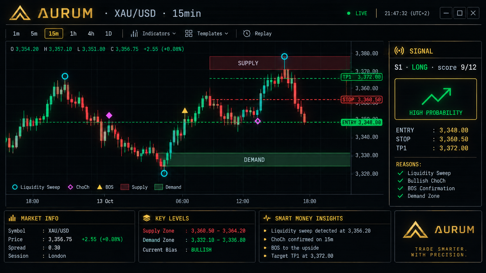

# Aurum · XAU/USD ICT Scanner



> A gold scanner that detects Smart Money Concepts (ICT) setups in real time — available as a **terminal (TUI)** app and a **local web UI**, both powered by the same Rust engine.

**Aurum** (Latin for *gold*) analyses live **XAU/USD** candles from [Twelve Data](https://twelvedata.com) and surfaces high-confluence trade setups using three independent strategy engines, each scored by a confluence model before being displayed.

Ships as **two binaries** sharing one codebase:

| Binary | Interface | Use case |
|---|---|---|
| `aurum-tui` | Terminal (ANSI chart + tables) | SSH, scripting, no browser |
| `aurum-web` | Local web UI (canvas chart + HTML table) | Visual review, screenshots, sharing on your LAN |

```
╔══════════════════════════════════════════════════════════════════════╗
║  AURUM · XAU/USD · 15min · 500 bars                                  ║
╚══════════════════════════════════════════════════════════════════════╝
  BIAS: LONG (last HTF BOS @ bar 110)

   2684.12 │                        ◆   █  ░░░░░░░░░░░░░░░░░░░░░░░
   2678.44 │                             █
   2672.76 │                   ▲        ██
   2667.08 │                           █
   2661.40 │  ▓▓▓▓ SUPPLY ▓▓▓▓▓▓▓▓▓▓▓▓▓▓▓▓▓▓▓▓▓▓▓▓▓▓▓▓▓▓▓▓▓▓▓▓
   2655.72 │                    ○        █
   2650.04 │                            ██
   2644.36 │                          ██
   2638.68 │                      ◆ ██
   2633.00 │══════════════ ENTRY ═══════════════════════════════════
   2627.32 │─────── STOP ───────────────────────────────────────────
   2621.64 │─────── TP1 ────────────────────────────────────────────
   2615.96 │─────── TP2 ────────────────────────────────────────────
   2610.28 │  ░░░ DEMAND ░░░░░░░░░░░░░░░░░░░░░░░░░░░░░░░░░░░░░░░░░░
   2604.60 │              ◈
   2598.92 │            ██
```

---

## Table of contents

- [Features](#features)
- [Prerequisites](#prerequisites)
- [Installation](#installation)
- [Configuration](#configuration)
- [Usage — terminal mode](#usage--terminal-mode)
- [Usage — web mode](#usage--web-mode)
- [Architecture](#architecture)
- [Strategies](#strategies)
- [Reading the chart](#reading-the-chart)
- [Confluence scoring](#confluence-scoring)
- [Project structure](#project-structure)
- [Development](#development)
- [Troubleshooting](#troubleshooting)
- [Data source & limits](#data-source--limits)
- [License](#license)

---

## Features

- **Real market data** — live XAU/USD OHLCV from Twelve Data (1min → 1day)
- **Three ICT strategy engines** in parallel:
  - Liquidity Sweep → MSS → Order Block → LTF IFVG
  - Double BOS → Supply/Demand → LTF Breaker Block
  - HTF ChoCh → Unmitigated FVG → LTF IFVG
- **Confluence scoring** (0–12) with reasoning — low-quality setups filtered out
- **Two frontends, one engine**:
  - `aurum-tui` — full ASCII chart directly in your terminal
  - `aurum-web` — local web UI (canvas chart) served by the Rust process
- **Same detection everywhere** — the web UI never re-implements strategies; it renders the Rust engine's JSON
- **API key never leaves the machine** — even in web mode the key lives in `.env` on the server, not in the browser
- **Multi-target exits** — TP1 (1R), TP2 (2R), TP3 (structure-based)
- **ATR-buffered stops** — no fixed pip counts
- **HTF bias + premium/discount filters** — trades aligned with the higher-timeframe narrative only
- **`.env`-driven configuration** — change symbol, timeframe, thresholds without recompiling

---

## Prerequisites

- **Rust 1.75+** — install from [rustup.rs](https://rustup.rs)
- **A free Twelve Data API key** — [twelvedata.com/register](https://twelvedata.com/register) (8 req/min, 800/day, no credit card)
- **Windows / macOS / Linux** — anything Rust supports
- For the web UI: any modern browser (Chrome, Firefox, Safari, Edge)

---

## Installation

```bash
git clone https://github.com/<you>/aurum.git
cd aurum

# Create .env from the template
cp .env.example .env            # Windows PowerShell: Copy-Item .env.example .env

# Paste your Twelve Data API key
$EDITOR .env

# Build both binaries
cargo build --release
# or: make release
```

Resulting binaries:

```
target/release/aurum-tui     ← terminal scanner
target/release/aurum-web     ← web server (embedded HTML, single binary)
```

Both read the same `.env` — no duplication, no separate config.

---

## Configuration

All settings live in `.env` and are read by both binaries:

```dotenv
TWELVE_DATA_API_KEY=your_key_here      # required
AURUM_SYMBOL=XAU/USD                   # instrument
AURUM_INTERVAL=15min                   # candle interval
AURUM_OUTPUTSIZE=500                   # number of candles to fetch
AURUM_WINDOW=100                       # candles shown in chart
AURUM_HTF_RATIO=5                      # LTF → HTF aggregation ratio
AURUM_MIN_SCORE=6                      # minimum confluence score to display
AURUM_PORT=3000                        # web server port (web mode only)
```

**Precedence order** (highest wins):

1. CLI argument — `aurum-tui 1h` overrides interval, `aurum-web --port 8080` overrides port
2. Process environment — `TWELVE_DATA_API_KEY=abc ./target/release/aurum-tui`
3. `.env` file
4. Built-in default

`.env` is gitignored. `.env.example` is committed.

### Common `AURUM_HTF_RATIO` values

| LTF interval | `AURUM_HTF_RATIO` | Effective HTF |
|---|---|---|
| `5min`  | 3  | 15min |
| `15min` | 4  | 1h    |
| `15min` | 16 | 4h    |
| `1h`    | 4  | 4h    |
| `1h`    | 24 | Daily |

Pick a ratio that puts your HTF at the timeframe you actually use for bias (1h or 4h are the classic choices).

---

## Usage — terminal mode

```bash
# default run — reads .env
./target/release/aurum-tui

# override interval from CLI
./target/release/aurum-tui 1h

# help
./target/release/aurum-tui --help

# via make
make tui
```

### Example output

```
◈ Aurum · XAU/USD · 15min · 500 bars · window=100 · HTF=1:5 · min_score=6
✔ fetched 500 real XAU/USD candles

╔══════════════════════════════════════════════════════════════════════╗
║  AURUM · XAU/USD · 15min · 500 bars                                  ║
╚══════════════════════════════════════════════════════════════════════╝
  BIAS: LONG (last HTF BOS @ bar 142)

  [ ASCII chart ]

  LEGEND  ▲▼ BOS  ◆ ChoCh  ✦ MSS  ○ Sweep  ◈ IFVG  ░ FVG
  ██ Supply  ██ Demand  ▶ Price  ══ Entry  ── SL  ── TP

  ┌─ SIGNALS ─────────────────────────────────────────────────────────────────────────┐
  │ #   STRATEGY           SIDE      ENTRY      STOP       TP1       TP2  ...  SCORE  │
  ├───────────────────────────────────────────────────────────────────────────────────┤
  │ 1   S1 Sweep+MSS+IFVG  LONG    2684.12   2671.30   2696.94   2709.76      9      │
  │     reasons: sweep · MSS · IFVG · S/D · fresh · HTF-align · vol                   │
  └───────────────────────────────────────────────────────────────────────────────────┘

  Total: 1 signal
```

---

## Usage — web mode

```bash
# start the local server
./target/release/aurum-web
# → ✔ Aurum web UI: http://127.0.0.1:3000/

# custom port
./target/release/aurum-web --port 8080

# via make
make web PORT=8080
```

Open the printed URL in your browser. The page shows:

- **Bias bar** — current HTF direction with the last structural event
- **Canvas chart** — candles, supply/demand zones, FVGs, IFVGs, BOS / ChoCh / MSS, sweeps, and entry/SL/TP bands
- **Signals table** — one row per setup with reasons as inline pills
- **Controls** — interval, bars, window, HTF ratio, min score

All analysis runs on the Rust server. The browser just calls `GET /api/analyze` and renders JSON. **Your API key is never sent to the browser.**

### Web UI safety notes

- Binds to **`127.0.0.1`** by default — not reachable from other machines
- No authentication — do not expose to a public network without a reverse proxy
- No telemetry, no analytics, no CDN calls
- `index.html` is embedded into the binary at compile time (`include_str!`) — one file, zero deployment friction

---

## Architecture

```
┌──────────────────────────────────────────────────────────────┐
│                                                              │
│  aurum-tui binary             aurum-web binary               │
│  ─────────────────            ──────────────────             │
│  Chart renderer               axum HTTP server               │
│  (ASCII, ANSI colors)         (GET /, GET /api/analyze)      │
│         │                              │                     │
│         └──────────────┬───────────────┘                     │
│                        ▼                                     │
│              aurum library (src/lib.rs)                      │
│              ─────────────────────────                       │
│              • Candle, Signal, Zone, Fvg types               │
│              • swings, structure, FVG, IFVG, order blocks    │
│              • strategy1, strategy2, strategy3               │
│              • confluence scoring                            │
│              • fetch_twelvedata (HTTP client)                │
│              • server module (axum)                          │
│                                                              │
└──────────────────────────────────────────────────────────────┘
                         │
                         ▼
              Twelve Data API
              (key in .env, never in browser)
```

Key properties:

- **One source of truth** — strategies live only in `src/lib.rs`
- **Two thin binaries** — each `main()` is < 200 lines of glue
- **No duplicated logic** — web UI is a renderer, not a reimplementation
- **Shared `.env`** — both binaries read the same config

---

## Strategies

Each strategy follows the same pipeline: **HTF context → POI → LTF trigger → scored entry**.

### 1 · Liquidity Sweep + IFVG

> *"The market hunts liquidity, breaks structure, then retests the order block that caused the move."*

1. HTF **liquidity sweep** (wick through a prior swing, close back inside)
2. HTF **MSS** (market structure shift) in the reversal direction
3. Mark the **order block** that caused the MSS
4. Wait for price to return to the OB
5. LTF **MSS** confirms
6. Enter on the LTF **IFVG** (inverse fair value gap) retest
7. Stop below the OB (bull) / above (bear); targets = 1R / 2R / structure

### 2 · Supply/Demand + Breaker Block

> *"Two consecutive breaks of structure validate a zone; the breaker is where you get filled."*

1. HTF **two consecutive BOS** in the same direction (no ChoCh between)
2. Mark the **supply/demand zone** that preceded the first BOS
3. Wait for price to return to the zone
4. Drop to LTF, look for **MSS**
5. Place a **limit order** at the **breaker block** (the opposite-colour candle just before the MSS)
6. Stop beyond the breaker; targets = 1R / 2R / structure

### 3 · HTF ChoCh + FVG

> *"A ChoCh after a strong trend leaves an unfilled gap — that gap becomes the retest entry."*

1. HTF **strong prior trend** (≥ 2 BOS in the opposite direction)
2. HTF **ChoCh** (first break of structure against the trend)
3. Find the **unmitigated FVG** created by the ChoCh leg
4. Wait for price to return to the FVG
5. LTF **IFVG** confirms
6. Enter on the IFVG; stop beyond the FVG; targets = 1R / 2R / structure

---

## Reading the chart

The same legend applies in both terminal and web modes:

| Symbol | Meaning | Colour |
|---|---|---|
| `▲` / `▼` | BOS (bullish / bearish) | bright yellow |
| `◆` | ChoCh — change of character | bright yellow |
| `✦` | MSS — ChoCh confirmed by a sweep | bright magenta |
| `○` | Liquidity sweep | bright cyan |
| `◈` | IFVG retest (entry trigger) | bright magenta |
| `░` | Fair value gap (fresh, unfilled) | dim |
| `██` (green) | Demand zone | dark green background |
| `██` (red) | Supply zone | dark red background |
| `██` (blue) | Bullish FVG | dark blue background |
| `██` (purple) | Bearish FVG | dark purple background |
| `██` (orange) | IFVG (flipped gap) | dark orange background |
| `══` | Entry price line | bright green |
| `──` (red) | Stop-loss line | bright red |
| `──` (yellow) | TP1 / TP2 / TP3 lines | bright yellow |
| `▶` | Current close price | bright white |

The **BIAS** header tells you the HTF narrative — LONG, SHORT, or NEUTRAL — along with the last structural event that set it.

---

## Confluence scoring

Every candidate setup is scored from 0 to 12. Only setups with `score ≥ AURUM_MIN_SCORE` (default 6) are displayed.

| Factor | Weight | What it means |
|---|---|---|
| **Sweep** | +2 | Liquidity sweep present on the relevant timeframe |
| **MSS** | +2 | Market structure shift (not a plain BOS) confirmed the reversal |
| **IFVG** | +2 | LTF inverse FVG gave the entry |
| **FVG** | +1 | An unmitigated FVG sits between entry and target |
| **S/D zone** | +1 | Entry is inside a marked supply/demand zone |
| **Fresh** | +1 | The zone / FVG has not been previously mitigated |
| **HTF align** | +1 | Trade direction matches the HTF bias |
| **P/D** | +1 | Entry is in the correct premium/discount half of the recent range |
| **Vol** | +1 | ATR is above the volatility floor (avoids dead markets) |

Raise `AURUM_MIN_SCORE` to **8** for A+ setups only; lower it to **5** in quiet markets if the scanner produces zero signals.

---

## Project structure

```
aurum/
├── Cargo.toml
├── Cargo.lock
├── Makefile
├── README.md
├── .env                    # your key — gitignored
├── .env.example            # template — committed
├── .gitignore
├── index.html              # embedded by aurum-web via include_str!
└── src/
    ├── lib.rs              # shared engine (types, detection, strategies, fetch)
    ├── server.rs           # axum server module (used by aurum-web)
    └── bin/
        ├── aurum-tui.rs    # terminal binary
        └── aurum-web.rs    # web binary
```

Inside `lib.rs`, sections are delimited by boxed comments:

- `DATA MODEL` — `Candle`, `Side`, `Zone`, `Signal`, …
- `DETECTION PRIMITIVES` — swings, sweeps, structure, FVGs, IFVGs, order blocks, ATR
- `CONFLUENCE SCORING` — `Factors`, `score()`, `build_signal()`
- `STRATEGY 1/2/3` — three independent scanners
- `DATA FETCHER` — Twelve Data HTTP client

The terminal chart lives in `src/bin/aurum-tui.rs` (it's not needed elsewhere). The server and embedded HTML live in `src/server.rs` / `index.html`.

---

## Development

The included `Makefile` wraps common commands:

| Command | Action |
|---|---|
| `make help` | List targets |
| `make setup` | Create `.env` from `.env.example` |
| `make build` | Debug build (both binaries) |
| `make release` | Optimized build → `target/release/aurum-{tui,web}` |
| `make tui` | Run the terminal scanner |
| `make web PORT=3000` | Run the web UI |
| `make check` | Type-check all targets |
| `make fmt` | `cargo fmt` |
| `make lint` | `cargo clippy --all-targets -- -D warnings` |
| `make clean` | Remove `target/` |

### Building only one binary

```bash
cargo build --release --bin aurum-tui
cargo build --release --bin aurum-web
```

### Optional: exclude axum from the TUI build

If you want `aurum-tui` without the web stack linked in:

```toml
[features]
default = ["web"]
web = ["dep:axum"]

[dependencies]
axum = { version = "0.7", optional = true }
```

And in `lib.rs`:

```rust
#[cfg(feature = "web")]
pub mod server;
```

Then:

```bash
cargo build --release --bin aurum-tui --no-default-features   # smaller, TUI only
cargo build --release --bin aurum-web                         # with axum
```

---

## Troubleshooting

### `can't find bin aurum-tui at path src/bin/aurum-tui.rs`

Cargo can't find a binary. Confirm:

```powershell
# Windows
Get-ChildItem -Recurse -Depth 2 -Include *.rs, *.toml
```

Expected layout:

```
aurum\Cargo.toml
aurum\src\lib.rs
aurum\src\server.rs
aurum\src\bin\aurum-tui.rs
aurum\src\bin\aurum-web.rs
aurum\index.html
```

### `TWELVE_DATA_API_KEY missing or placeholder`

You haven't set your key. Run `make setup`, edit `.env`, and paste your key from [twelvedata.com/register](https://twelvedata.com/register).

### `Twelve Data API error: ...`

The API returned an error message. Common causes:

| Message | Cause | Fix |
|---|---|---|
| `apikey is invalid` | Typo or expired key | Re-copy from your dashboard |
| `You have reached the limit of requests` | 8 req/min or 800/day exceeded | Wait, or upgrade plan |
| `symbol XAU/USD not available` | Your plan doesn't include XAU/USD | Free tier *does* include it — check the key is on the right account |
| `interval is invalid` | Misspelled interval | Use `1min`, `5min`, `15min`, `30min`, `1h`, `4h`, `1day` |

### `need ≥100 candles (got N)`

Your fetch returned fewer candles than the analysis requires. Raise `AURUM_OUTPUTSIZE` or use a larger interval.

### Terminal chart looks garbled

Your terminal needs **256-color ANSI** support and a font with box-drawing characters (`█`, `░`, `│`, `─`). On Windows, use **Windows Terminal** or **VS Code's integrated terminal** — the old `cmd.exe` console misrenders colors.

### Web UI shows "Cannot reach the Aurum server"

The Rust process isn't running, or the port changed. Confirm:

```bash
# is aurum-web running?
./target/release/aurum-web --port 3000

# is the port open?
curl http://127.0.0.1:3000/api/analyze?interval=15min
```

If the process is running, check that you opened `http://127.0.0.1:<port>/` — not `https://` and not a different port.

### Web UI shows an error in the status bar

The Rust server forwards Twelve Data's error text verbatim. Common cases match the API table above. Open DevTools → Network → `/api/analyze` to inspect the raw JSON response.

### Port already in use

```bash
# use a different port
./target/release/aurum-web --port 8080

# or find and kill the current holder
# macOS/Linux:
lsof -ti:3000 | xargs kill
# Windows PowerShell:
Get-NetTCPConnection -LocalPort 3000 | Select-Object OwningProcess | Stop-Process
```

---

## Data source & limits

- **Provider:** Twelve Data — [twelvedata.com](https://twelvedata.com)
- **Endpoint:** `GET /time_series?symbol=XAU/USD&interval=...&outputsize=...`
- **Free tier:** 8 requests/minute, 800 requests/day, no credit card
- **Data coverage:** XAU/USD spot, ~20 years of history, 1min → 1day bars
- **Response order:** newest-first → the fetcher reverses to chronological
- **Authentication:** API key only (public market data — no signing, no secrets in headers)

Each run of either binary makes **exactly one Twelve Data request**, so you can run the terminal and the web UI side by side without doubling your quota (each still counts as 1).

---

## License

MIT — see [`LICENSE`](LICENSE) if present, or add one before publishing.

---

## Disclaimer

Trading gold (XAU/USD) on leverage carries substantial risk of loss. This tool is for **educational and research purposes only**. Signals are algorithmic outputs, not financial advice. Past performance of any strategy shown here does not guarantee future results. Never risk capital you cannot afford to lose.